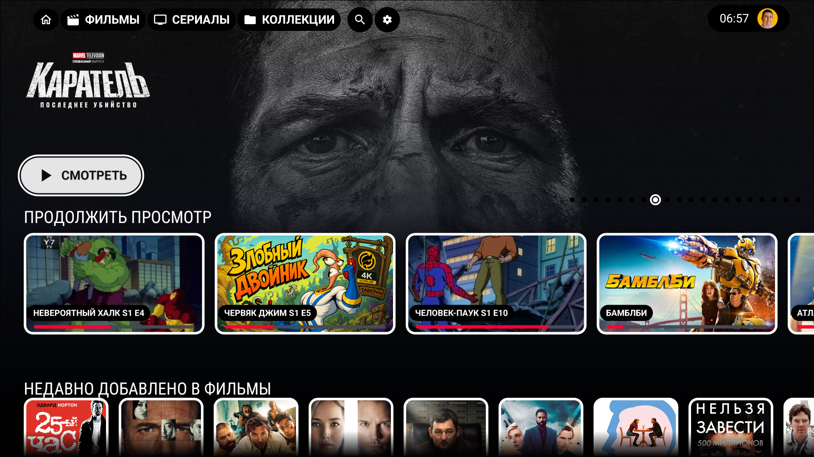
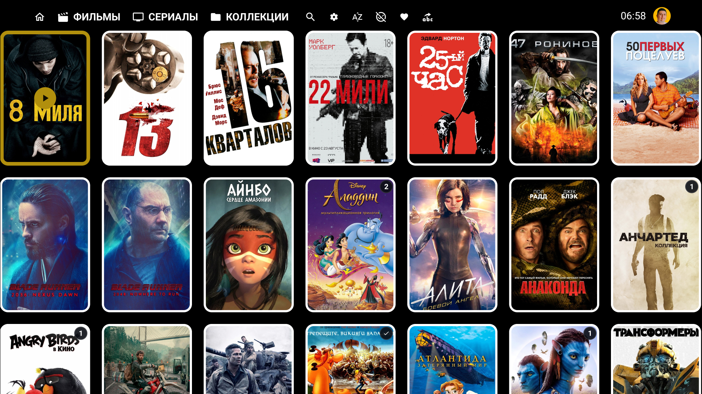
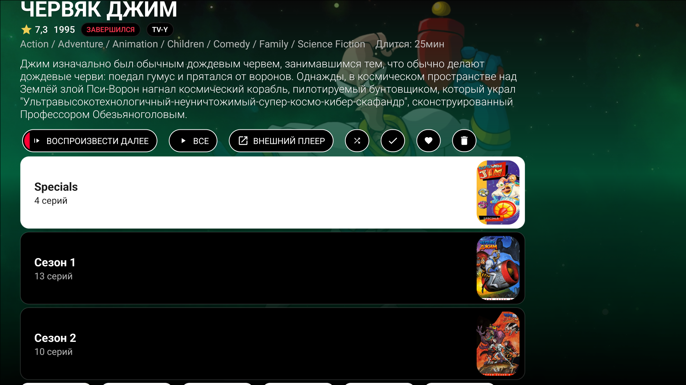

<p align="center">

</p>
<h3 align="center">Форк <a href="https://github.com/jellyfin/jellyfin-androidtv">Jellyfin Android TV</a> с переработанным интерфейсом</h3>

---

KFIN — это Jellyfin для Android TV с полностью переосмысленным внешним видом: единый тёмный стиль без лишних подложек, акцентные цвета, взятые из постеров, полупрозрачный плеер и внимание к плавности работы на слабом железе.

Пакет приложения — `org.kfin.androidtv`: устанавливается отдельно и не конфликтует с оригинальным Jellyfin.

## Скриншоты

<!-- СКРИН 1: главный экран (карусель + ряды) -->


<!-- СКРИН 2: библиотека (сетка постеров, статус-бар с капсулами) -->


<!-- СКРИН 3: страница фильма/сериала (описание, кнопки, плашки) -->


<!-- СКРИН 4: сезоны/серии плашками с постерами -->


<!-- СКРИН 5: страница актёра -->


<!-- СКРИН 6: плеер с панелью управления -->


<!-- СКРИН 7: меню плеера (качество/дорожки/субтитры) -->


## Ключевые особенности

### Интерфейс

- **Карусель на главном экране** — полноширокая лента рекомендуемого контента с кинематографичным бэкдропом: логотип тайтла, кнопка «Смотреть» и точечный индикатор страниц; под ней сразу ряд «Продолжить просмотр».
- **Статус-бар без подложки** — капсулы библиотек, поиск, настройки, часы и пользователь прямо на фоне; в покое чёрные, при фокусе — статичное белое выделение с тёмным содержимым.
- **Карточки** — белая обводка в покое, акцентный цвет постера при фокусе, кружок воспроизведения по центру; бейджи количества серий и индикации просмотра с 90% непрозрачности.
- **Страница контента** — серии и сезоны плашками: название слева, описание в две строки с многоточием (плашка не растягивается), портретный постер со скруглением справа.
- **Страница актёра** — фото фиксированного размера со скруглением, имя справа от фото; сетка актёров 6 в ряд.
- **Единая геометрия** — заголовок, описание, кнопки, списки и сетки выровнены по общей границе 28dp на всех страницах.
- **Меню в едином стиле** — чёрные с мягким контуром: настройки, сортировка, контекстное меню (удержание OK), выбор внешнего плеера; без затемнения фона.

### Плеер

- Чёрная панель у нижнего края экрана, все элементы с **60% непрозрачности** (логотип — без прозрачности).
- Верхний ряд: перемотка, воспроизведение, время; нижний ряд: дорожки, субтитры, качество, скорость, масштаб — кнопки-капсулы с инверсией иконки при фокусе.
- Название и время над прогресс-баром; меню качества/дорожек/субтитров открываются над панелью фиксированными ячейками.
- Встроенный движок — **ExoPlayer (Media3)**; внешние плееры (VLC, MX Player, mpv, Vimu) поддерживаются через отдельную кнопку.

### Производительность

- Не более 2 параллельных декодов изображений (Coil) — скролл сеток без пропусков кадров на слабых ТВ-боксах.
- Memory cache зафиксирован на 25% хипа (без автоурезания на low-RAM устройствах).
- Серверное уменьшение картинок: бэкдропы до 1920px, превью до 1280px, логотипы до 640px — без 4K-оригиналов.
- Блюр фона заменён акцентной заливкой, у карточек нет теней и зума — только анимация обводки.
- Релизные сборки: R8 + сжатие ресурсов (~30 МБ APK).

### Платформа

- minSdk 23 (Android 6+), целевая платформа — Android 11 и новее, приоритет — ТВ-боксы.
- Совместимость с сервером Jellyfin 10.9+.

## Установка

Скачайте APK из раздела [Releases](https://github.com/kad-lex/kfin-androidtv/releases) и установите на устройство. Для обновлений используется тот же пакет — новые версии ставятся поверх.

## Patch notes

### v0.2.0-rc.2 (pre-release) — первый публичный пререлиз

**Интерфейс**
- Статус-бар: капсулы библиотек, часы и пользователь без подложки, статичное белое выделение.
- Карточки: обводка с акцентом постера при фокусе, кружок воспроизведения, бейджи 90% непрозрачности.
- Страница контента: список серий/сезонов плашками с портретными постерами, описание с многоточием.
- Страница актёра: фиксированное фото со скруглением, имя справа от фото.
- Сетка актёров 6 в ряд, выравнивание всего по общей границе 28dp.
- Плеер: чёрная панель у нижнего края, элементы с 60% непрозрачности (кроме логотипа), кнопки-капсулы, меню над панелью.
- Меню в едином стиле: чёрные с мягким контуром, без затемнения фона.

**Производительность**
- Coil: не более 2 параллельных декодов, memory cache 25% хипа.
- Серверное уменьшение картинок: бэкдропы 1920, превью 1280, логотипы 640.
- Плеер: стилизация кнопок только при смене состава (без обходов дерева на каждый кадр).

**Исправления**
- Имя актёра больше не обрезается за фото; у всех актёров одинаковый размер фото.
- Постеры в плашках сезонов получили видимое скругление (портретный слот с заполнением).
- Навигация по сетке актёров: движение строго по строкам/столбцам, без диагоналей.

## Сборка из исходников

```bash
# debug
./gradlew :app:assembleDebug -Pjellyfin.version=0.2.0

# release (нужен keystore, см. signingConfigs в app/build.gradle.kts)
./gradlew :app:assembleRelease -Pjellyfin.version=0.2.0
```

Требования: JDK 21, Android SDK.

## Благодарности и лицензия

KFIN основан на [Jellyfin Android TV](https://github.com/jellyfin/jellyfin-androidtv) и наследует его лицензию [GPL 2.0](LICENSE). Вся команда Jellyfin — авторам апстрима.
